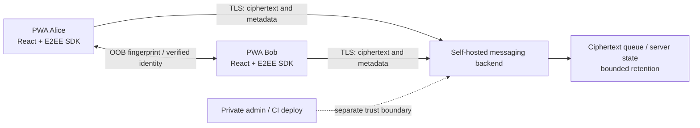

# VeilChat — PWA Security Architecture & Development Roadmap

> **Status:** DRAFT / architecture decision pending  
> **Updated:** 2026-10-29  
> **Audience:** contributors, security reviewers, maintainers  
> **Product:** self-hostable, open-source, privacy-first web messenger  
> **Safety gate:** **NOT READY FOR REAL OR SENSITIVE MESSAGES.** This document is a plan, not an assurance or independent security audit.

## 1. Goals and non-goals

VeilChat's primary target is an installable **Progressive Web App (PWA)** for modern Android, iOS, and desktop browsers. The preferred UI stack is **Vite + React + TypeScript**; deployment targets **Docker/Compose and Coolify on a Debian VM under Proxmox**. Keep a small operational footprint; prioritize correctness over nominal RAM savings.

**In scope for MVP:** 1:1 text messaging, browser-side E2EE using a maintained implementation, user/device identity verification, ciphertext-only transit, secure delivery and retries, reconnect, explicit error states, and minimal metadata and retention.

**Out of scope for first MVP:** group chat, voice/video, attachments, link previews, third-party scripts/analytics, push as a required dependency, custom cryptographic primitives/protocols, and claiming compromised devices can be made trustworthy.

Avoid making the product depend on Android-only attestation, native secure-screen APIs, mandatory Google services, blockchain, or proprietary cloud services.

## 2. What previous research and PoC establish

The research evaluated **12 GitHub projects/repositories** and focused on browser-compatible E2EE, key management, self-hosting, service workers, XSS, and compromised endpoints.

In the reported lab, **Chromium 153 and Firefox 157** ran independent browser clients using **Wire CoreCrypto 10.5.4 (Rust/WASM)** with the Go starter relay. The lab recorded **14 passing test scenarios**, including both directions of ciphertext exchange, tamper and replay rejection at the recipient SDK, an offline/reconnect delivery scenario, and selected rendering/CSP/cache checks. A separate two-Chromium run also passed those scenarios. **These were limited synthetic PoCs, not an audited product or deployment test.**

Important qualifications:

- The prototype trusted an out-of-band controller for expected invitation fingerprint data; it did **not** implement full human identity verification.
- The replay rejection occurred in the browser SDK; the **original relay still accepted duplicate submissions**.
- The lab used HTTP on loopback, not a public-domain Coolify/TLS deployment.
- Canary scans of nine relay envelopes found no six selected plaintext markers after transport Base64 decoding; this is a limited observation, not universal proof of non-disclosure.
- **Safari/WebKit, physical Android/iOS, mobile battery/performance, production TLS, and live Proxmox/Coolify deployment were not verified.**
- The CoreCrypto/OpenMLS-fork snapshot reviewed raised **unresolved patch-status concerns** for upstream OpenMLS advisories [GHSA-gc79-23g3-8g52](https://github.com/openmls/openmls/security/advisories/GHSA-gc79-23g3-8g52) and [GHSA-94v4-rg25-x625](https://github.com/openmls/openmls/security/advisories/GHSA-94v4-rg25-x625). Do not call the fork vulnerable or fixed without confirming its patch and reproducing relevant tests.

The Go starter audit identified design gaps around inbox creation limits, unauthenticated send/write authority, duplicate/replay behavior, destructive GET before ACK, TTL cleanup, retained memory references, response I/O under a lock, and input/resource limits. The starter is a **prototype**, not a production-ready relay. Passing unit tests does not remove those gaps.

## 3. Architecture decision record (ADR-001) — **OPEN**

Two paths remain mutually exclusive for the primary backend; do not combine them casually.

| Path | Client E2EE | Backend | Tradeoff | Status |
|---|---|---|---|---|
| **A — Matrix** | Matrix JS SDK + Rust crypto WASM | Synapse (or independently evaluated compatible homeserver) + PostgreSQL | Browser SDK and messaging ecosystem are more complete, but a Matrix homeserver and its operational/security model are required. Go queue is **not** a drop-in Matrix backend. Megolm's security properties must not be conflated with a full Double Ratchet / MLS PCS guarantee. | **Recommended for fastest browser-product integration; approval required** |
| **B — Custom Go + MLS** | Vetted browser MLS SDK | Hardened Go ciphertext relay with explicit enrollment, key-package, delivery and ACK contracts | Retains a minimal Go backend and transport control, but adds significant protocol integration, recovery, identity and security-review obligations. The Wire/CoreCrypto fork patch issue is a release blocker until resolved. | **Research PoC succeeded; not cleared for production** |

**No backend is approved by this file.** Before implementing product E2EE, record the chosen path and rationale here or in a follow-up ADR; document chosen SDK/version, transitive dependency pinning, licensing, advisory disposition, threat model, and migration implications. Do not silently switch protocols.

### Proposed logical design

If choosing Matrix, `API` means a Matrix homeserver implementing the Matrix client-server protocol. If choosing Go + MLS, it means a purpose-built relay and supporting enrollment/key-package services. Treat frontend **origin and build delivery** as a separate, highly sensitive trust boundary: an attacker able to replace served JS/WASM can steal plaintext after decryption, even when relay E2EE is sound.

## 4. Threat model and security guarantees

| Threat | Planned mitigation | Remaining limitation |
|---|---|---|
| Untrusted Wi-Fi / ordinary MITM | HTTPS/WSS, correct certificate validation, E2EE and verified peer keys | Network observers may learn endpoint/time/volume metadata; hostile client origin still defeats secrecy |
| Compromised relay | Client-side E2EE, authenticated keys, minimize logging and retention | Relay may drop, delay, replay, reorder, or observe metadata |
| Key-substitution at enrollment | Out-of-band safety number/QR confirmation, explicit key-change warnings, device transparency strategy | Verification is only as trustworthy as the second channel and user's device |
| Tampering and replay | Authenticated encryption/SDK replay protection; server dedup and authenticated ACK | Different layers are separately tested; server replay acceptance must not be disguised as SDK protection |
| XSS and malicious dependencies | Text-only rendering, strict CSP, Trusted Types where supported, vetted dependencies, locked builds, no remote scripts | Same-origin malicious JS/build compromise can use keys or capture displayed plaintext |
| Service worker / cache leakage | Allowlist cache only versioned non-sensitive assets; never cache API, tokens, plaintext, decrypted attachments | Service worker itself can be malicious if origin or release pipeline compromised |
| Browser key theft | Encrypted-at-rest crypto state, explicit unlock and recovery, minimal key lifetime, controlled storage and worker state | WebCrypto non-extractability is not a hardware-backed guarantee; authorized malicious JS can invoke key operations |
| Screen recording, accessibility spyware, extensions, remote access | Minimize visible lifetime, generic notifications, deliberate clipboard actions, screen lifecycle lock | **PWA cannot guarantee screenshots/OS screen recording are blocked**, nor protect displayed plaintext against system-level compromise |
| Rooted/fully controlled OS | Revoke and re-enroll from independently trusted endpoint; explain risk transparently | **No PWA guarantee of confidentiality once the OS/display is fully hostile** |
| Browser storage eviction / multiple tabs | Recovery/re-enrollment policy, transactional state, one-writer coordination | Data/key loss may be unrecoverable; do not silently regenerate identity |
| Lost connectivity / offline messages | Bounded encrypted outbox, non-destructive fetch, ACK after durable client commit, delivery status | Background delivery may pause when mobile OS suspends the PWA |

### No false assurance

Do **not** claim protection against an attacker who has full access to OS/kernel, accessibility readout, screen recording, browser extensions, or malicious application JavaScript. Session safety checks can verify **observable prerequisites**; they cannot certify a device spyware-free. No custom crypto protocol.

## 5. Browser security baseline

**Content and DOM:** React escaped text output by default; never render message content with `dangerouslySetInnerHTML`, markdown-to-HTML without strict sanitization, or unsafe URL sinks. Disable link previews/remote images by default. Test DOM injection, URL and event-handler payloads.

**CSP:** serve a restrictive **HTTP response header** on the production HTML document, not only a meta tag. Aim for `default-src 'none'`; narrowly define `script-src`, `style-src`, `connect-src`, `worker-src`, `img-src`, `manifest-src`, `base-uri 'none'`, `object-src 'none'`, `frame-ancestors 'none'`, `form-action` as applicable. Never permit `unsafe-eval` for convenience. Assess the minimum WebAssembly compile policy (for example `wasm-unsafe-eval`) with actual target browsers. Avoid third-party JS/CDNs and inline scripts.

**Trusted Types:** enforce where browsers support it, use strict policies only, and keep safe fallbacks on browsers without enforcement.

**Service worker:** add only after the cache/update threat model is tested. Cache *allowlisted versioned static assets only*; explicitly bypass requests to API/auth/crypto, private routes, responses containing confidential headers, and all decrypted media. `Cache-Control: no-store` alone does **not** stop a service worker from calling Cache API.

**Persistence and keys:** never place private keys, token plaintext, decrypted chat histories or session secrets in `localStorage`, query strings or logs. Encrypt necessary persisted crypto state; design unlock/backup/recovery carefully. IndexedDB encrypted state is **not equivalent to hardware-backed secure storage**. Prevent concurrent mutation of ratchet/group state across tabs; handle crash/rollback and migrations.

**Origin integrity:** separate frontend from administrative access; protect CI/CD, dependencies, branch protections, release signatures, static asset hosting, secrets and permissions. E2EE is not effective against replaced frontend code.

**Headers and network:** verify HTTPS/WSS on real origin, HSTS after domain validation, origin/CORS rules, secure cookies if applicable, CSRF protections for cookie-authenticated endpoints, safe referrer policy and logging hygiene. Be mindful that `display-capture=()` is **not** an OS screenshot blocker.

**PWA:** installability (manifest and icons), update lifecycle, offline shell behavior, iOS/Android storage eviction, page visibility, suspend/resume, and notifications require physical-device validation. Push must remain optional; no mandatory cloud dependency.

## 6. Backend contract — if Go is selected

The audited starter must be hardened **before** use with real traffic:

1. Separate inbox enrollment, **send/write capability**, read capability, and ACK authority; prevent unauthorized sender spam and enumeration.
2. Implement per-client/IP/user and **global** quotas (inbox count, message count, byte budget, open connections, request body, dedup state); measure memory at maximum queue occupancy.
3. Give each message an authenticated identifier and digest; implement idempotent retries and replay controls independent of the endpoint SDK.
4. Make fetch **non-destructive**; delete only on valid authenticated ACK after durable client state commit. Explicitly handle disconnect and ACK loss.
5. Enforce TTL with bounded background cleanup; zero stale references where meaningful; define server time semantics and expiration states.
6. Never hold global store locks across network I/O; use context cancellation, timeouts, graceful shutdown, race and stress tests.
7. Store only ciphertext and minimal routing metadata; no message content or secret-bearing URL/query logs.
8. Apply Docker hardening: unprivileged user, read-only root where feasible, dropped capabilities, seccomp, resource budgets, pinned base digests and dependency SBOM.

If Matrix is selected instead, use its documented API semantics and deployment controls; **do not adapt the Go queue as a transparent replacement**.

## 7. Delivery plan — small, auditable PRs

| PR | Scope | Evidence/acceptance criteria | Principal risk |
|---|---|---|---|
| **#1 — PWA foundation** | Vite/React/TS scaffold, manifest, architecture status | Build, typecheck, lockfile, CI, correct prototype warning; no false security claims | Unverified dependencies and insecure build defaults |
| **#2 — Architecture decision & threat model** | Select A or B, protocol/SDK dependency BOM, license review, identity and recovery design | Signed-off ADR, advisory disposition, trust-boundary diagram, test plan | Locking into unsupported crypto/transport |
| **#3 — Browser security foundation** | CSP/Trusted Types, no third-party scripts, safe message-rendering primitives, SW policy | Automated CSP/XSS/cache tests in Chromium + Firefox; Safari testing tracked | Browser differences, injected JS |
| **#4 — Backend integration and hardening** | Matrix pilot **or** Go auth/quotas/ACK/TTL/API contract | Unauthorized access, replay, resource pressure, delivery loss and race tests | Duplicate/lost ciphertext and server DoS |
| **#5 — E2EE integration** | Supported SDK, identity confirmation, key-change UX, transactions, encrypted persistence | Two-client E2EE, tamper/replay, invite substitution, crash and recovery tests | Key substitution, state rollback, supply chain |
| **#6 — Minimal secure messaging** | 1:1 text, delivery states, offline encrypted outbox, reconnect, explicit unlock | End-to-end product workflow, no plaintext server logs/storage, crash/retry consistency | Privacy and message-loss regressions |
| **#7 — Mobile/browser verification & benchmarks** | Android Chrome, iOS Safari installed/uninstalled, desktop browsers, 2/10/50 sessions | Actual device/OS/SDK versions and measurable latency/RAM/CPU/battery; FAIL/BLOCKED reported honestly | Misleading desktop-to-mobile extrapolation |
| **#8 — Self-host deployment review** | Docker/Compose, Coolify, reverse proxy TLS, backup/restore, monitoring, SBOM | Repeatable fresh deploy/restore; TLS tests; secret isolation; rollback and update drills | CI/origin compromise, persistence leakage |

PR numbering after #1 is a **plan**, not a claim that PRs already exist. Keep each change reviewable. Require testing and review; never auto-merge.

### Release gates

- **Research/experimental:** synthetic data only; may run on localhost. No private messages.
- **Private alpha:** selected E2EE SDK security issues resolved, documented identity verification, successful cross-engine and mobile-device tests, no critical unresolved auth/XSS/cache failures.
- **Public beta:** independent code review, recovery and state rollback tests, deployment security validation and incident response documentation.
- **Production claim:** requires separate security approval and ideally independent external assessment. **No fixed calendar ETA is promised.**

## 8. Development quality and CI

For every PR: pinned dependency graph with committed lockfile, reproducible clean installation, TypeScript strict mode, lint, production build, dependency/license/advisory review, secret scanning, and review of security-sensitive diff. Run API tests, `go test -race` (if Go), browser security tests, and deterministic synthetic ciphertext fixtures where applicable. Do not accept a CI badge as security certification.

Capture test evidence: device/browser/version, environment, command or steps, expected vs actual, PASS/FAIL/BLOCKED, logs with secrets redacted, artifact hashes, and known exclusions.

## 9. Deployment plan for Proxmox / Coolify

- Use a dedicated Linux VM on Proxmox for Docker/Compose/Coolify-managed workloads; do not run application containers directly on the hypervisor.
- Isolate public HTTPS ingress, API/homeserver network, database/queue, and admin plane. Keep database and management endpoints private.
- Serve frontend static artifacts from a hardened origin with tested headers. A separate frontend domain helps separate boundaries but **does not protect against an administrator/CI with control of both origins**.
- For **Matrix**: pilot Synapse + PostgreSQL; document registration, federation policy, backups, encrypted rooms, secrets, database migration and monitoring.
- For **Go + MLS**: use bounded ciphertext queue and documented authenticated endpoints; never expose unfinished starter directly to the Internet.
- Start with resource reservations, then right-size from **actual** TLS+E2EE tests. Do not equate small empty-queue RSS with safe worst-case RAM.
- Encrypt backups and exclude plaintext; document key recovery tradeoffs. Prefer generic operational metrics over message-identifying logs.

## 10. Decisions needed from maintainer

- [ ] Choose **A: Matrix + homeserver** or **B: hardened Go + vetted browser MLS**.
- [ ] Define account/enrollment and peer identity verification (QR/fingerprint/OOB).
- [ ] Define storage/recovery on browser data loss and tab concurrency.
- [ ] Define message TTL, maximum size, and offline retention budgets.
- [ ] Define acceptable availability tradeoffs without mandatory push cloud.
- [ ] Approve test device/browser matrix and release gates.
- [ ] Decide who may deploy/modify production frontend JS and how releases are reviewed.

**Next action:** complete the PR #1 lockfile/build/CI review if still pending, approve ADR-001, then begin PR #2/#3 in order. Do not start a full messaging application until the architecture, identity model and key lifecycle are approved.

## 11. Primary references

- [Matrix JS SDK](https://github.com/matrix-org/matrix-js-sdk)
- [Matrix spec — Olm/Megolm](https://spec.matrix.org/latest/olm-megolm/)
- [Signal libsignal implementation](https://github.com/signalapp/libsignal) — Node/native binding constraints
- [Wire CoreCrypto](https://github.com/wireapp/core-crypto)
- [OpenMLS](https://github.com/openmls/openmls)
- [Messaging Layer Security, RFC 9420](https://www.rfc-editor.org/rfc/rfc9420.html)
- [W3C Web Cryptography API](https://www.w3.org/TR/WebCrypto/)
- [MDN Content Security Policy](https://developer.mozilla.org/en-US/docs/Web/HTTP/CSP)
- [MDN Service Worker API](https://developer.mozilla.org/en-US/docs/Web/API/Service_Worker_API)
- [MDN Trusted Types](https://developer.mozilla.org/en-US/docs/Web/API/Trusted_Types_API)
- [WebKit Web Push on iOS/iPadOS](https://webkit.org/blog/13878/web-push-for-web-apps-on-ios-and-ipados/)
- [Synapse Docker documentation](https://github.com/element-hq/synapse/blob/develop/docker/README.md)

**Evidence provenance:** The preceding findings are summarized from the VeilChat PWA research report and its synthetic PoC record from 2026-10-29. This roadmap is not an independent re-execution of those tests. Validate historical test artifacts and exact pinned dependency hashes before using the evidence as a release gate.
